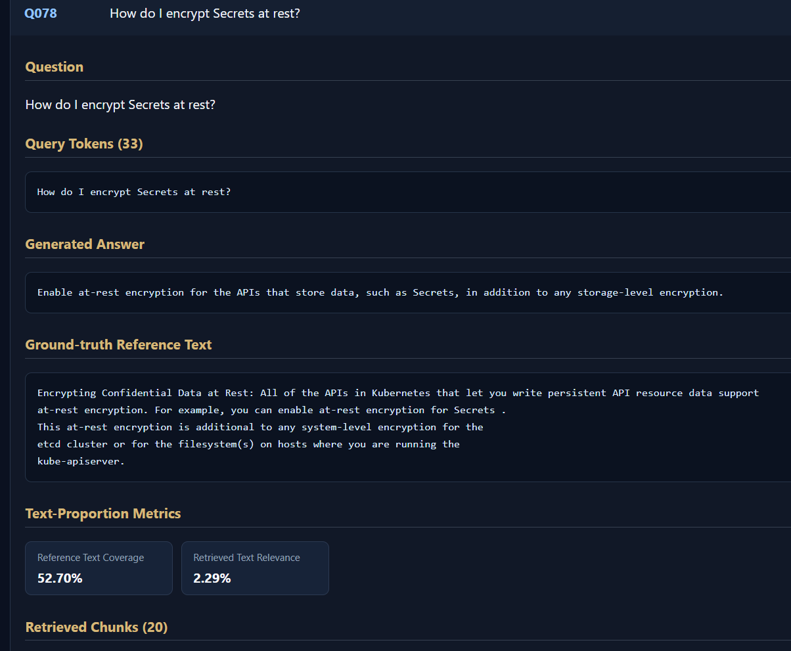
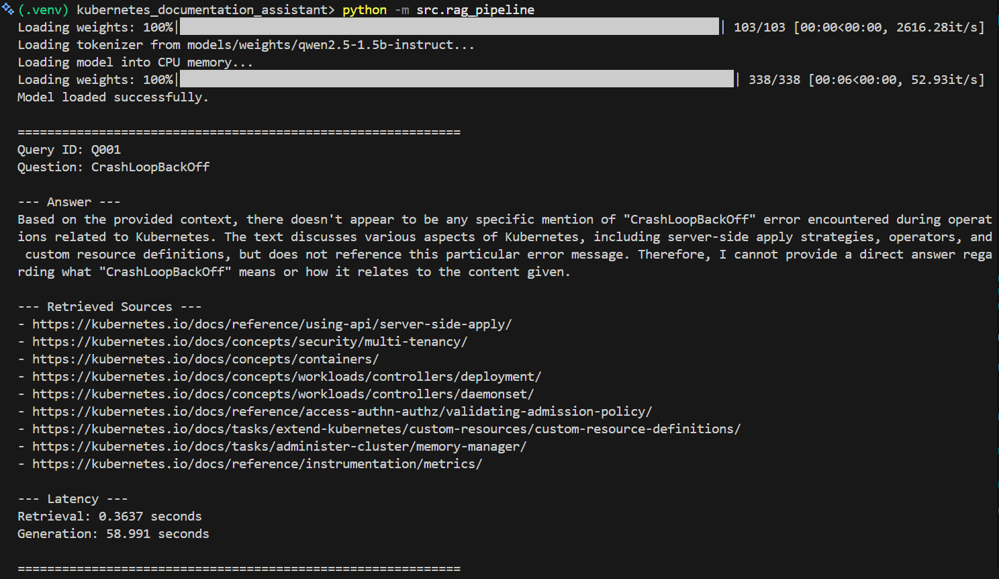
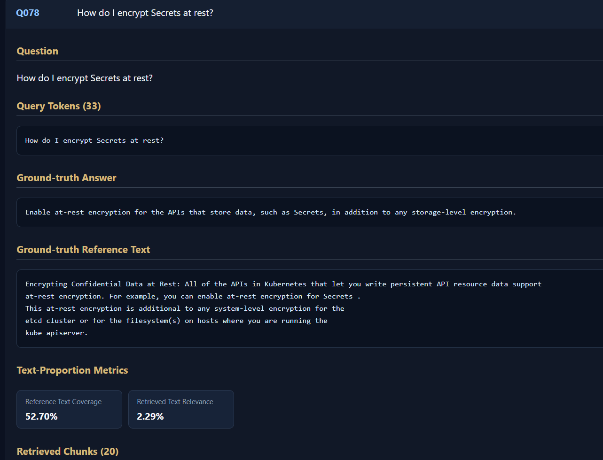
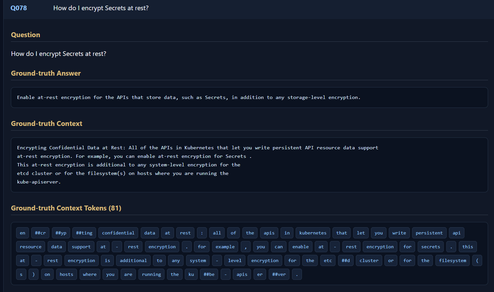
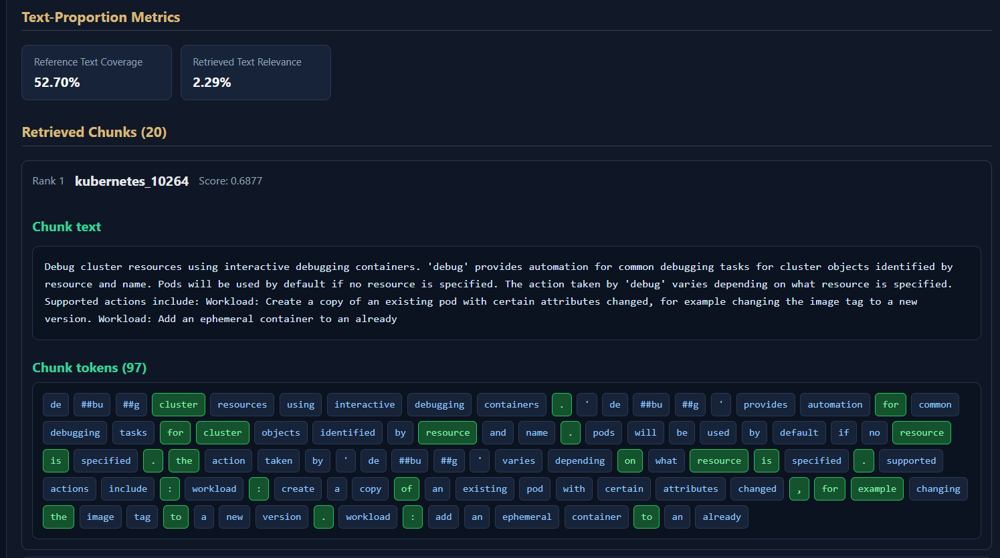
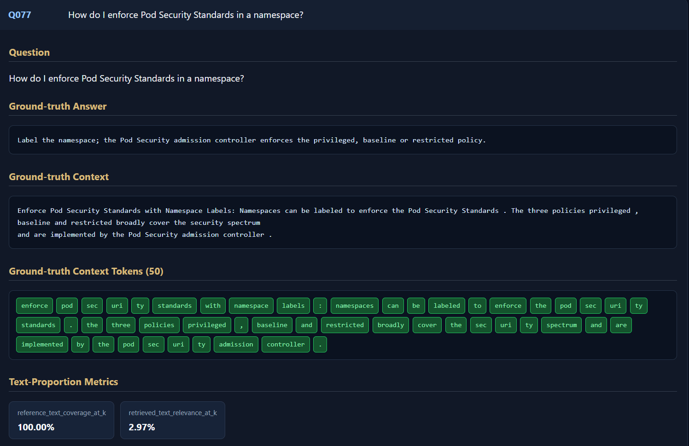
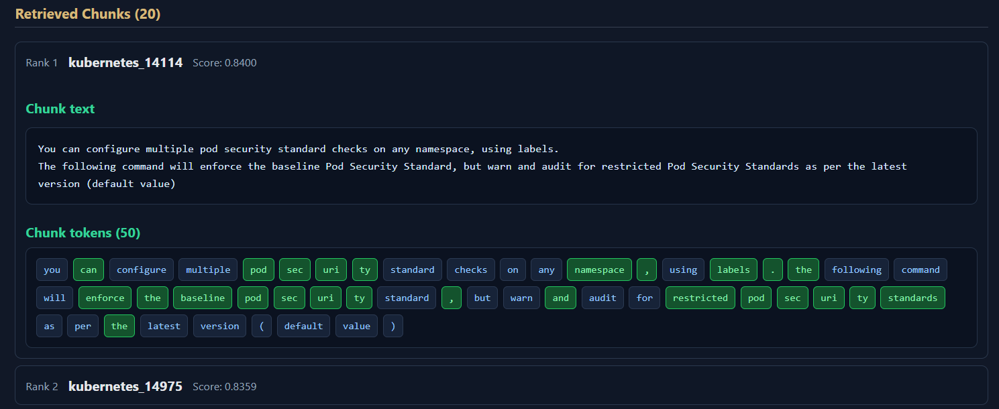

# 14/10/26

1. ## Create setup

   - ``git init``
   - virtual environment setup
     - ``py -m venv .venv``
     - ``.venv\Scripts\Activate``
   - created
     - logs.txt
     - README.md
     - requirements.txt
     - .gitignore
     - ``configs/corpus.yaml``
     - `src/ingestion/____init____.py`
     - `src/ingestion/_1fetch_docs.py`
2. ## Fetch documentation

   - python -m ``src.ingestion._1fetch_docs`` -> ``data/raw/kubernetes/index.html`` -> 500744 characters downloaded
3. ## Extract text from HTML file

   - create ``src/ingestion/_2extract_text.py``
   - python -m ``src.ingestion._2extract_text`` -> 2084 characters extracted
4. ## Token-based chunking

   - add tokenizer to ``configs/corpus.yaml``
   - create ``src/ingestion/_3chunk_text.py``
   - run python -m ``src.ingestion._3chunk_text``
5. ## Expand Corpus

   - add more ``source_urls`` in ``configs/corpus.yaml``
6. ## Validate Chunks

   - create ``src/ingestion/_4validate_chunks.py``
   - run ``python src/ingestion/_4validate_chunks.py``
7. ## Add Evaluation Qs

   - Create ``configs/queries.yaml``
8. ## BM25 retrieval

   - create ``src/retrieval/_5bm25_retriever.py``
   - run ``python src/retrieval/_5bm25_retriever.py`` -> results saved to ``experiments/bm25/results.jsonl``
9. ## Evaluates the BM25 results using Recall@10, MRR, and Hit Rate

   - create ``src/evaluation/_6evaluate_retrieval.py``
   - run ``python src/evaluation/_6evaluate_retrieval.py``
10. ## Push to Github

    - git add .
      git status
      git commit -m "set up pipeline"
    - git branch -M main
      git remote add origin https://github.com/YOUR_USERNAME/rag-retrieval-frontier.git
      git push -u origin main

    ## Pipeline:

* HTML pages: downloaded 4 Kubernetes documentation pages.
* Text extraction: We extracted their content into `.txt` files.
* Chunking: We split the extracted text into 100 chunks, targeting 512 tokens with 128-token overlap.
* Retrieval algorithm(BM25): ranks the chunks and returns the top 10.

---

# 15/10/26

1. ## Added


   - comments
     - `src/ingestion/`_`2extract_text.py`
     - `src/ingestion/`_`3chunk_text.py`
     - `src/ingestion/`_`5bm25_retriever.py`
     - `src/ingestion/_6evaluate_retrieval.py`
   - Experimental Scope to `README.md`
2. ## Created


   - `configs/retrieval.yaml`

   Pipeline:

* HTML pages: downloaded 4 Kubernetes documentation pages.
* Text extraction: We extracted their content into `.txt` files.
* Chunking: We split the extracted text into 100 chunks, targeting 512 tokens with 128-token overlap.
* Retrieval algorithm(BM25): ranks the chunks and returns the top 10.
* Evaluate Retrieval (Recall@10, Precision@10, MRR, Hit rate@10)

---

# 16/10/26

1. ## Created

   - `src/models/_`_`6download_models.py`
   - run `python src.models._`_`6download_models.py` -> `models/weights/qwen2.5-1.5b-instruct`
   - `src/models/`_`7load_models.py`
   - run `python src\models\`_`7load_models.py`
   - `src/generation/_8llm_inference.py`                <- loads model for each query
   - run `python src.generation._8llm_inference`
2. ## Update

   - `src.generation._8llm_inference` to load model and use for subsequent queries
3. ## Created

   - `src.retrieval._5bm25_index.py`
   - `src.retrieval._5test_bm25_index.py`
   - run `python -m src.retrieval.test_bm25_index`
   - `src.generation.rag_pipeline.py`
   - run `python -m src.generation.rag_pipeline.py`
4. ## Good achievement

   - *retrieval took only 0.0018 secs*: so BM25 not the bottleneck here
5. ## Issues

   - *high latency*: generation took 252.499 seconds (~4 mins) to ans single query
   - *incomplete ans*: stops mid-sentence
   - *retrieved context includes multiple sources*: some maybe irrelevant to the query
6. ## Solution

   - reduce *Generation cost*

---

# 17/10/26

1. ## Added

   - comments
     - `src.retrieval._4bm25_index.py`
     - `src.retrieval._v4test_bm25_index.py`
     - `src.models.__4download_models.py`
   - code file
     - `src.utils.helpers.py` -> added `filename_from_url` and deleted this function from `1..py` and `2..py`
     - `src.evaluation.evaluate`
2. ## Shifted all Rag configuration info to configs.yaml
3. ## Built spider to scrape all URLs from Kubernetes official webpage

---

# 18/10/26

1. some sites present inside sites, so updated fetc_docs
2. save URLs in a separate file to retrieve that as references during ans generation -> `data.raw.kubernetes_urls.jsonl` -> saved as sources in `data.processed.kubernetes.chunks`
3. model download stopped due to internet disconnection so redownloaded
4. Committed first version

---

# 19/10/26

1. added precision@10 to evalution.py
2. add run_pipeline() to do evaluation by simply calling `src.rag_pipeline.py`
3. ## Document-level(URL) -> Chunk-level Retrieval evaluation


   - very low precision(0.07), though good recall(0.4667)
   - ### Workflow

     - added `relevant_chunk` to `queries.yaml` along with `query` and `answer`
4. ## Added `faithfulness`, `hallucination_rate`, `answer_completeness` to generation metrics


   - created `src.evaluation.generation_metrics`

   ## Base values:

   - retrieval_latency <= 0.2 seconds
   - generation_latency <=1.5 seconds

| Pipeline Stage                       | Target Baseline Value (ms)  | (s)   | Notes / Triggers                                                         |
| ------------------------------------ | --------------------------- | ----- | ------------------------------------------------------------------------ |
| **Query Embedding**            | **5 – 15**           | 0.015 | Time taken to convert user text into vectors.                            |
| **Vector Index Retrieval**     | **10 – 150 ms**      | 0.15  | Vector database lookup (e.g., Pinecone, Qdrant, Milvus).                 |
| **Reranking Stage**            | **30 – 100 ms**      | 0.1   | Optional but normal if using Cross-Encoders (e.g., Cohere).              |
| **Time to First Token (TTFT)** | **100 – 300 ms**     | 0.3   | Measures how fast the user sees text start streaming.                    |
| **LLM Generation**             | **1,000 – 1,500 ms** | 1.5   | Dominates ~80% of total latency; highly dependent on output token count. |

---

# 21/10/26

1. ## Updated `__4bm25_index.py` to build index for the dataset once and saved it locally in `data\index\bm25_index.pkl`

   * earlier -> created the index for the whole doc each time `__4bm25_index.py`  was executed
   * and saved it temporarily in memory
2. ## Separated metrics in `src.evaluation.evaluate.py` into:  -> implement *separation of concerns*

- `src.evaluation.retrieval_metrics.py`
- `src.evaluation.retrieval_metrics.py`

3. ## Updated:

   - `rag_pipeline.py`
   - `evaluate.py`
4. ## Issues

   - retrieval quality poor: no relevant chunk in top_k for query_001

     Configured top_k: 20

     ---

     Chunk: kubernetes_08038
     BM25 score: 14.3176
     BM25 rank: 42 / 27193
     Matched query tokens: ['api', 'server', 'api', 'priority', 'and', 'request']

     Chunk: kubernetes_08039
     BM25 score: 7.2808


     - BM25 rank: 2055 / 27193
     - Matched query tokens: ['priority', 'request']
   - ~6 seconds to load model weights into memory on executing `evaluate.py`
5. ## Separated Tokenizer into `src.tokenization.tokenization.py`

---

# 22/10/26

1. ## Applied Open/Closed Principle of SOLID Principles on Evaluation


   - created:
     - `src/evaluation/evaluation_context.py`
     - `src/evaluation/base.py`
     - `src/evaluation/registry.py`
     - `src/evaluation/generation/`     <- separate folders for generation and retrieval metrics
     - `src/evaluation/retrieval/`
2. ## Baseline measurements:

   ### Retrieval


   - *hit rate of 0.60* : 60% of queries retrieved at least one relevant chunk within the evaluation cutoff
   - *Recall of 0.4194* : many labeled relevant chunks were not retrieved.
   - *Precision@10* : approximately one in ten retrieved chunks were relevant on average

   ### Generation

   - faithfulness = 0.0
   - answer completeness = 0.0
   - hallucination rate = 0.9333

   #### Interpretation:

   - Genuine judge scores
   - weakness of small judge model
   - problem in how response is interpreted
3. ## Added


   - TTFT & TPOT
     - `from transformers import TextIteratorStreamer` imports a utility class from the **Hugging Face `transformers` library** used to **stream text in real time** as a Large Language Model (LLM) generates it
   - Utility functions in `src/evaluation/utils.py`
     - earlier used from cache
     - `average`, `round_metric`, `PeakMemoryMonitor`, and `evaluate_retrieval`
4. ## Issues


   - Retrieval quality
   - Generation quality
   - CPU inference performance
5. ## Solution


   - Use ***D**ense Retrieval*
6. ## Created


   - `src/embeddings/embeddings.py`  -> `data/embeddings/kubernetes_minilm_embeddings.npy`  <- Embedding shape: (27193, 384)
   - `src/retrieval/dense_retrieval.py`

---

# 24/10/26

1. ## Added Hybrid Retrieval

   - `src/retrieval/hybrid_retrieval.py`
   - updated
     - `src/rag_pipeline.py`
     - `src/evaluation/evaluate.py`
     - `configs.yaml`
2. ## updated

   - added model names to retrieval file names
3. ## Added ReRanker

   - created
     - `src/reranker/cross_encoder.py`
4. ## Added `scripts/view_query_results.py` to show per query metrics on browser

---

# 25/10/26

1. ## Study

   - dense retrieval
   - hybrid retrieval
   - reranking
2. ## Added

   - in `src/utils/helpers.py`
     - `load_yaml()`
     - `load_config()`
     - `load_chunks()`
     - `get_queries()`
3. ## `sentence-transformers/all-MiniLM-L6-v2`

   - `all` : trained on all available datasets i.e. model is 'all-rounder'
   - `MiniLM` : Miniaturized Language Model (originally developed by Microsoft)
     - heavily compressed version of larger models like BERT
   - `L6` : 6 Transformer Layers unlike 12 Transformer Layers in standard base models
     - cuts the computation time in half and the model can process the text repidly
   - `v2` : Version 2

---

# 26/10/26

## 1. Add domain-related keywords to tokenizer vocabulary to avoid splitting them into smaller tokens

- `src/embeddings/test_embeddings.py`

  ```
  Query: How do Kubernetes API server logs help diagnose API Priority and Fairness request handling?
  Tokens: ['how', 'do', 'ku', '##ber', '##net', '##es', 'api', 'server', 'logs', 'help', 'dia', '##gno', '##se', 'api', 'priority', 'and', 'fairness', 'request', 'handling', '?']
  Kubernetes                     -> ['ku', '##ber', '##net', '##es']
  CrashLoopBackOff               -> ['crash', '##lo', '##op', '##back', '##off']
  APIService                     -> ['api', '##ser', '##vic', '##e']
  API Priority and Fairness      -> ['api', 'priority', 'and', 'fairness']
  ```
- `src/embeddings/extract_keywords.py`   ->  `data/candidate_keywords.txt`
- `src/embeddings/rank_keywords.py`   -> `data/kubernetes/ 3 .py files`
- `src/embeddings/analyze_keyword_counts.py`

  ```
  Total keywords analyzed: 5864

  Keywords with frequency > 50: 296
  Keywords with frequency > 80: 183
  Keywords with frequency > 100: 143

  Keywords with > 40 subwords: 19
  Keywords with > 30 subwords: 33
  Keywords with > 20 subwords: 106
  ```
- `src/embeddings/update_minilm_emb_vocab/add_tokens_to_vocab.py`   ->  `models\kubernetes_tokenizer_updated_vocab `

  ```
  vocabulary size: 30522 -> 30722  :  200 new tokens added (150 high-frequency and 50 high-subword words)
  Failed tokens: 6 : not legitimate Kubernetes vocabulary, 
             instead artifacts: data errors, noise, or junk formatting that accidentally got pulled along with the clean data.
  ```
- Renamed:  `src/embeddings/embeddings.py`  ->  `src/embeddings/original_vocab_embeddings.py`
- `src/embeddings/new_minilm_vocab_embeddings.py`

  ```
  Embedding matrix size: (30522 * 384)  ->  (30722 * 384)
  ```

## 2. Create intial embeddings for 200 new words from existing subwords

- created:
  - `src/embeddings/train_new_token_emb/initialize_new_token_emb.py`  ->  `models\kubernetes_updated_minilm_initialized\`
  - `models\kubernetes_updated_minilm_initialized\initialization_metadata.json`
  - `src\embeddings\new_minilm_vocab_embeddings.py`  -> `data/embeddings/kubernetes_minilm_initialized_embeddings.npy`

```
███████████████████████████████████████████████████████████████████████████████████████████████████| 103/103 [00:00<00:00, 2100.63it/s]
Model vocabulary size: 30722
Embedding shape: (27193, 384) : (chunks, each embedding length)
```

## Summary

- Expanded tokenizer to increase its vocabulary to **30,722 tokens** from **30,522 tokens**
- initialized 194 new token embeddings by averaging the pretrained embeddings of their original subword component
- saved the expanded tokenizer inside model's directory
  - now model reloads with updated tokenizer
  - it recognizes those 200 words as individual tokens
    - instead of splitting them into smaller subwords

---

# 27/10/26

## 1. Evaluate Initialized model

* updated
  * `src\retrieval\dense_retrieval_minilm.py` added if-else block to choose `EMBEDDING_PATH` as per the model chosen in configs automatically

## 2. Removed 6 failed tokens as they didn't belong to Kubernetes vocab

- ### updated

  - ``src/embeddings/update_minilm_emb_vocab/add_tokens_to_vocab.py`` : tokenizer-building script
  - `src/embeddings/train_new_minilm_token_emb/initialize_new_token_emb.py` : initialization script
  - `src/embeddings/new_minilm_vocab_embeddings.py` : embedding-generation script
- ### ran

  - Step 1: Add tokens to the tokenizer vocabulary:  `python -m src.embeddings.update_minilm_emb_vocab.add_tokens_to_vocab`
  - Step 2: Initialize the new token embeddings:  `python -m src.embeddings.train_new_minilm_token_emb.initialize_new_token_emb` -> `data\embeddings\kubernetes_minilm_initialized_embeddings.npy`

    ```
    Model vocabulary size: 30722
    Sentence embedding dimension: 384
    Generating embeddings for 27193 chunks...
    Batches: 100%|█████████████████████████████████████████████████████████████████████████████████████████████████████████████| 425/425 [38:16<00:00,  5.40s/it]
    Embedding shape: (27193, 384)
    ```
- ### failed to build proper condition to remove all `generated identifiers`, `runtime-specific resource names`, or `encoded/container-ID artifacts`

  - in ``python -m src.embeddings.update_minilm_emb_vocab.add_tokens_to_vocab``
  - so sent the list of 200 new tokens to ChatGPT to identify them and built terminal code to delete them from updated vocabulary
    - created & ran `src/embeddings/update_minilm_emb_vocab/remove_unwanted_tokens.py`  -> rebuilt vocab by including only rest 175 valid tokens

      ```
      Original expanded vocabulary: 30722
      Added tokens before removal: 200
      Unwanted tokens found: 25
      Tokens to retain: 175
      Final vocabulary size: 30697
      ```
    - #### again initialized new token embeddings:

      `python -m src.embeddings.train_new_minilm_token_emb.initialize_new_token_emb` -> `data\embeddings\kubernetes_minilm_initialized_embeddings.npy`
    - #### updated MiniLM embeddings

      `python -m src.embeddings.new_minilm_vocab_emb`  ->  `data\embeddings\kubernetes_minilm_initialized_embeddings.npy`


      ```
      Sentence embedding dimension: 384
      Generating embeddings for 27193 chunks...
      Batches: 100%|█████████████████████████████████████████████████████████████████████████████████████████████████████████████| 425/425 [24:50<00:00,  3.51s/it]
      Embedding shape: (27193, 384)
      ```

## 3. Added chunk and query tokens to web page displayed on running evaluate

* updated
  * `dense_retrieval_minilm.py` : adds chunk tokens to `results` & returns `results` & `query_tokens`
  * `src.evaluation.evaluate`
  * `src\evaluation\evaluate.py`
  * `scripts\view_query_results.py`

## Result of adding 196 words to vocab

### 1. Dense

- recall_at_k             :  0.2417 -> 0.4639
- precision_at_k       : 0.03      -> 0.0533
- mrr                          :  0.3006 -> 0.3295
- hit_rate_at_k           :  0.4333  -> 0.6333
- latency_s                 :  0.0145  -> 0.0884
- peak_memory_mb :  546.375  -> 544.9107

### 2. Hybrid

- recall_at_k             :  0.4694 -> 0.5556
- precision_at_k       :  0.055   -> 0.065
- mrr                          :  0.4128 -> 0.4099
- hit_rate_at_k          :   0.6333  -> 0.7
- latency_s                 :  0.1205   -> 0.1799
- peak_memory_mb :  695.02   ->  695.7243

### 3. Sparse

- recall_at_k             :  0.4972 -> 0.4972
- precision_at_k       :  0.0583 -> 0.0583
- mrr                          :  0.4743  -> 0.4743
- hit_rate_at_k           :  0.6333  -> 0.6333
- latency_s                  :  0.1056  -> 0.1107
- peak_memory_mb :  503.521 ->  503.5913

not much effect on `Sparse Retrieval` as it doesn't use the embeddings.

recall, precision, mrr and hit rate increased for rest

latency and peak_memory also increased for all

---

# 28/10/26

## 1. Add 1000 new tokens to original vocab

```
Total keywords analyzed: 5864

Keywords with frequency > 30: 512
Keywords with frequency > 20: 765
Keywords with frequency > 10: 1647

Keywords with > 15 subwords: 195
Keywords with > 10 subwords: 429
Keywords with > 3 subwords: 3182
```

- choose: 500 words form both categories in ``src.embeddings.update_minilm_emb_vocab.add_tokens_to_vocab``
- ran:
  - `python -m src.embeddings.update_minilm_emb_vocab.add_tokens_to_vocab`  ->  `models\kubernetes_upd_tokenizer_vocab`
  - `python -m  src.embeddings.update_minilm_emb_vocab.remove_unwanted_tokens`  ->   `models\kubernetes_upd_tokenizer_vocab`

    ```
    Removed 153 unwanted tokens.
    Final vocabulary size: 31362
    Retained added tokens: 840
    ```
  - `python -m src.embeddings.train_new_minilm_token_emb.initialize_new_token_emb`

    - Model saved to: `C:\Users\palla\OneDrive\Desktop\Kubernetes RAG project\kubernetes_documentation_assistant\models\kubernetes_updated_minilm_initialized`
    - Metadata saved to: `C:\Users\palla\OneDrive\Desktop\Kubernetes RAG project\kubernetes_documentation_assistant\models\kubernetes_updated_minilm_initialized\initialization_metadata.json`
  - `python -m src.embeddings.new_minilm_vocab_emb`

## Result of adding 840 words to vocab

### a. Dense

- recall_at_k             :  0.2417 -> 0.4639  ->  .45
- precision_at_k       :  0.03      -> 0.0533  ->  0.0533
- mrr                          :  0.3006 -> 0.3295  ->  0.3037
- hit_rate_at_k           :  0.4333  -> 0.6333  ->  0.6
- latency_s                 :  0.0145  -> 0.0884  ->  0.1085
- peak_memory_mb :  546.375  -> 544.9107  ->  550.4783

### b. Hybrid

- recall_at_k             :  0.4694 -> 0.5556  ->  0.5667
- precision_at_k       :  0.055   -> 0.065  ->  0.0667
- mrr                          :  0.4128 -> 0.4099  ->  0.3896
- hit_rate_at_k          :   0.6333  -> 0.7  ->  0.6667
- latency_s                 :  0.1205   -> 0.1799  ->  0.9748
- peak_memory_mb :  695.02   ->  695.7243  ->  698.232

```
getting same metrics values in each run because of linear search.
```

## 2. Embedding storage: numpy array -> ChromaDB

- brute-force linear search  ->  Approximate Nearest Neighbor (ANN) search
- create:  `src/vector_store/index_chroma.py`
- run: `python -m src.vector_store.index_chroma`  ->  `data\chroma_db`

  ```
  Stored records: 27193
  Database location: C:\Users\palla\OneDrive\Desktop\Kubernetes RAG project\kubernetes_documentation_assistant\data\chroma_db
  Execution time: 12.30 seconds
  ```
- updated:

  - `src/retrieval/dense_retrieval_minilm.py` to load embeddings form chromadb
  - `src/evaluation/evaluate.py`

  ### Dense


  - latency_s                 :  0.0145  -> 0.0884       ->  0.1085     ->  0.046
  - peak_memory_mb :  546.375  -> 544.9107  ->  550.4783  ->  576.341

  latency decreased by 57.6% & peak memory increased by only 4.7%, so wil use chroma
- ChromaDB uses more memory since it maintains additional data structures to support **indexed vector search, persistent storage, and document management**

---

# 29/10/26

- Context generated contains: top_k × 512 tokens
- for k = 10, = 5,120 tokens
- **Try out :** Grep, Glob  ->  Hybrid RAG

---

# 30/10/26

- added "Regenerate records using git hash" section to `Readme.md`

## Experiment: 001

- **Aim:** change similarity search: cosine -> euclidean distance (l2) in `src\vector_store\index_chroma.py`
- **Short Commit hash**: 92fbb96
- **Files changed**:

  - `src\vector_store\index_chroma.py`
- **Results:**

  - ```
    - Stored records: 27193
      Database location: C:\Users\palla\OneDrive\Desktop\Kubernetes RAG project\kubernetes_documentation_assistant\data\chroma_db_l2
      Execution time: 9.43 seconds
    ```

    ### Dense

    - 1st run

      - latency_s                 :  0.0145  -> 0.0884       ->  0.1085      ->  0.046      ->  0.0378
      - peak_memory_mb  :  546.375  -> 544.9107  ->  550.4783  ->  576.341  ->  576.2767
    - 2nd run

      - latency_s                 :  0.0145  -> 0.0884       ->  0.1085      ->  0.046      ->  0.0378  ->  0.0349 -> 0.0217
      - peak_memory_mb  :  546.375  -> 544.9107  ->  550.4783  ->  576.341  ->  576.2767  ->  575.8413 -> 576.0443
- **Inferences:**

  - latency reduction by similarity search in chromadb: 57.6% (`cosine`) < 65.16% (`l2`) < 80% (`ip`) -> l2 similarity search produces faster retrievals
  - on running 2nd time,  chromadb fetches the index data directly from RAM cache built by 1st run. so, latency reduces 2nd run onwards.
  - Peak memory was broadly similar between the two L2 runs, with a small decrease in the second run.
  - `ip` similarity search is best for normalized embedding vectors
  - ====
- removed `git_commit` from `evaluation_results.py`
- **try:**

  - Elevate Context with Structural Strategies
    - HyDE
    - Metadata Pre-Filtering
    - Parent-Child Retrieval
  - Overcome the "Lost in the Middle" Phenomenon
  - Two-Stage Retrieval Architecture
  - experiment with smaller chunks: (256,64), (384,96)
  - fine-tune embedding model on corpus
    - create 500, 1000 examples(query, positive response, -ve repsonse) (8 topics) <- use hard negative
    - epochs: 3 -> 5 -> ....as per results  <- keep noting metrics at each stage
    - include diff query styles:
      * Short queries: `CrashLoopBackOff`
      * Technical queries: `kubectl rollout undo`
      * Natural-language questions: `How do I expose a Deployment inside the cluster?`
      * Troubleshooting questions: `Why is my Pod stuck in Pending?`
      * Multi-concept questions involving multiple Kubernetes resources.
  - LoRA
- study:

  - rrf
  - chromadb

---

# 31/10/26

## Created new queries

- created: `data/queries.csv`
- updated:
  - `src\utils\helpers.py` -> replaced ``def get_queries()``
  - `src\rag_pipeline.py`

## Exp002: `dense_chroma_ip`

* **Aim:** Evaluate Retrieval Recall for different chunk sizes and overlapping ratios

- **Short Commit hash:**
- **Files modified:**

  - `configs.yaml` :
    - `chunk_size`and `chunk_overlap`in `chunking`
    - `version_name` in `evaluation`
- **Files executed (for each experiment):**

  - `python -m scripts.chunking.chunk_html_text`
  - `python -m scripts.vector_store.index_chroma`
  - `src\evaluation\evaluate.py`
- **Results:**

| Exp      | Chunk size (tokens) | Overlap ratio | Overlap (tokens) | Total chunks | recall_at_20 | precision_at_20 | mrr_at_20 | hit_rate_at_20 | latency_s | peak_memory_mb |
| -------- | ------------------: | ------------: | ---------------: | ------------ | -----------: | --------------: | --------: | -------------: | --------: | -------------: |
| Baseline |                 512 |           25% |              128 | 27193        |         0.45 |          0.0533 |    0.3037 |            0.6 |    0.0217 |       576.0443 |
| 1        |                 512 |            5% |               26 | 22556        |          0.3 |          0.0367 |     0.137 |            0.4 |    0.0265 |       568.9237 |
| 2        |                 512 |           10% |               51 | 23477        |          0.3 |          0.0367 |     0.137 |            0.4 |    0.0287 |         571.83 |
| 3        |                 512 |           20% |              102 | 25827        |           — |              — |        — |             — |        — |             — |
| 3        |                 256 |            0% |                0 |              |           — |              — |        — |             — |        — |             — |
| 4        |                 256 |           10% |               26 |              |              |                 |           |                |           |                |
| 5        |                 256 |           20% |               51 |              |              |                 |           |                |           |                |
| 6        |                1024 |           10% |              102 |              |           — |              — |        — |             — |        — |             — |
| 7        |                1024 |           20% |              205 |              |           — |              — |        — |             — |        — |             — |

## 2. check why chunks retrieved have so less tokens.

- chunk ids was retrieved in place of chunk text.
- made corrections in below files:
  - `src\evaluation\evaluate2.py`
  - `scripts\view_query_results.py`
  - `src\retrieval\dense_retrieval_minilm.py`
- re: regular expression module, provides powerful pattern-matching techniques

## 3. Created new queries: 8f2f8c2

- 150 qs
- 5 varieties (30 qs each)
- storing relevant paragraph text, in place of chunk id in queries.csv
  - so that when chunking strategy is changed, no changes have to be made in queries.csv
- Saved queries generation prompt in `docs\queries_generation_prompt.txt`

---

# 1/11/26

1. ## Review evaluation result for dense_512_10%_150q with new queries

   


   - ### Issue:


     - whether `Generated Answer` shown after all `Retrieved Chunks` is generated in current run, or previously genreated answers are shown.
     - ### Reviewed code files

       - `src\models\load_models.py`

         - `data\chunks\chunks_512_51.jsonl`
         - `data\queries.csv`
       - `src\retrieval\dense_retrieval_minilm.py`
       - `src\rag_pipeline.py`

         - taking lot of time for ans generation: ~ 1 min for each query

           
     - ### Discovered

       - `Generated Answer` not produced in the current run.

         - instead `Ground-Truth Answer` was displayed as `Generated Answer`
   - added option in `configs.yaml` to evaluate a single query
   - replaced query tokens with  ground-truth context tokens in .html response
   - also changed the look of ground truth context and retrieved chunk tokens in web page

     - correct chunk tokens displayed as green

     
   - ### Inference


     - very poor retrieval: just punctuations and common words like articles are in common(Green)

---

# 4/11/26

## seeing chunk token ids in place of chunk text

- corrected `evaluate2.py`: was checking whether whole of the chunk lies in the ground truth context.
- chromaDB's metadata storing only `chunk_index` and no source
- no. of chunks(22,556) != no. of embeddings(27,193), created by `scripts.vector_store.index_chroma`

  - reason -> regenerated chunks but reused embeddings from the previous chunking configuration.
  - solution -> everytime chunking config changed in `configs.yaml`:

    - generate chunks -> `python -m scripts.chunking.chunk_html_text`
    - generate embeddings -> `python -m src.embeddings.new_minilm_vocab_emb`
    - index into ChromaDB -> `python -m scripts.vector_store.index_chroma`

    evaluate retrieval -> `python -m src.evaluation.evaluate`
  - updated:
  - - `src/embeddings/new_minilm_vocab_emb.py` -> embedding files now chosen automatically as per the config instead of using just one (~15 min)
    - ``scripts/vector_store/index_chroma.py`` -> embeddings chosen from respective files as per config (~0.5 min)
    - ``scripts/vector_store/verify_chroma.py``
    
 



